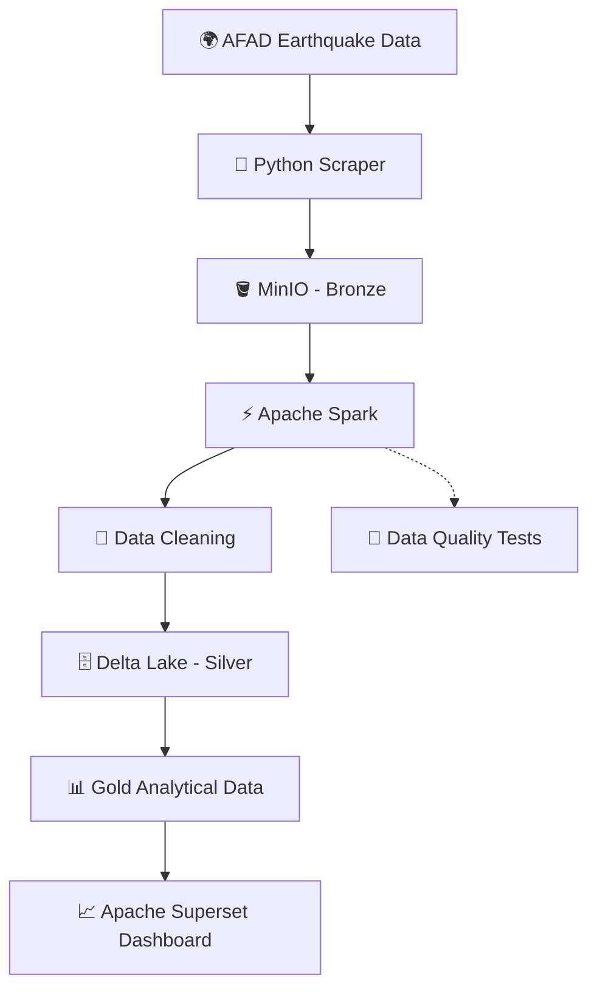
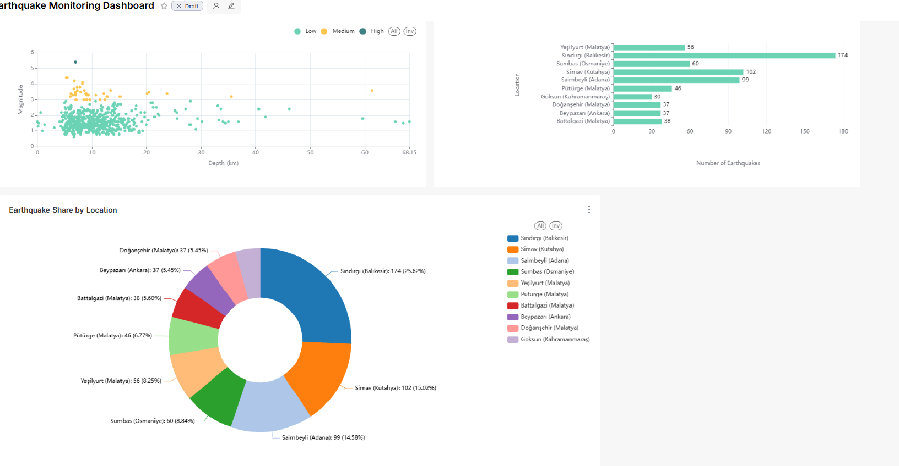

# Earthquake Data Engineering Pipeline

An end-to-end data engineering project that collects earthquake data from AFAD, processes it with Apache Spark, stores cleaned data in Delta Lake, and prepares analytical datasets for Apache Superset.

## 🌍 Why This Project Matters

🌐 **Real-World Value**
- 🏘️ **Public Awareness:** Explore earthquake locations, magnitudes, depths, and historical patterns.
- 🏢 **Business Applications:** The same data engineering concepts support finance, e-commerce, gaming, and logistics.
- 🔬 **Research Centers:** Organize earthquake records for scientific analysis and research.

## 🚀 What This Project Demonstrates

🔄 **End-to-End Data Engineering**
- 📥 **Data Ingestion:** Collect earthquake records from AFAD.
- 🥉 **Bronze Layer:** Store raw data in MinIO.
- ⚡ **Data Processing:** Clean and validate data using Apache Spark.
- 🥈 **Silver Layer:** Store processed data in Delta Lake.
- 🥇 **Gold Layer:** Prepare analytical datasets.
- 📊 **Visualization:** Explore results with Apache Superset.
- 🐳 **Infrastructure:** Use Docker to run project services.
- 🧪 **Data Quality:** Apply validation rules and testing practices.

⏱️ **Data Type:** This project collects earthquake records from an external source. It is not a guaranteed real-time streaming pipeline; data freshness depends on the source and collection schedule.

🎯 **Key Takeaway:** This project demonstrates many core data engineering concepts, from data ingestion and storage to transformation, data quality, and analytics.

## Architecture

AFAD → MinIO (Bronze) → Apache Spark → Delta Lake (Silver) → Gold → Apache Superset

## Dashboard Preview

## Technologies

- Python
- Apache Spark
- Delta Lake
- MinIO
- Apache Superset
- Docker

## Key Features

- Automated earthquake data collection
- Data cleaning and transformation
- Bronze, Silver, and Gold data layers
- Analytical datasets for visualization

## Project Status

Portfolio project under development.

## Note

Configuration files and credentials are intentionally excluded from this public repository. Local environment variables are required to run the pipeline.
